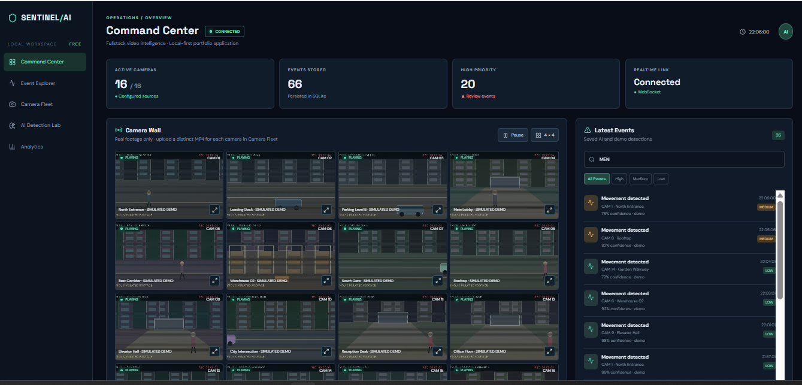
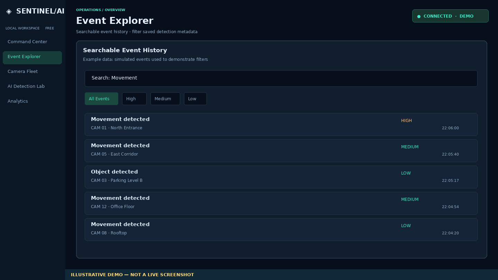
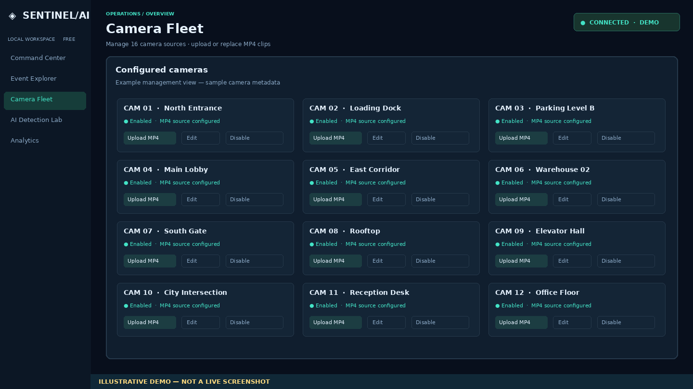
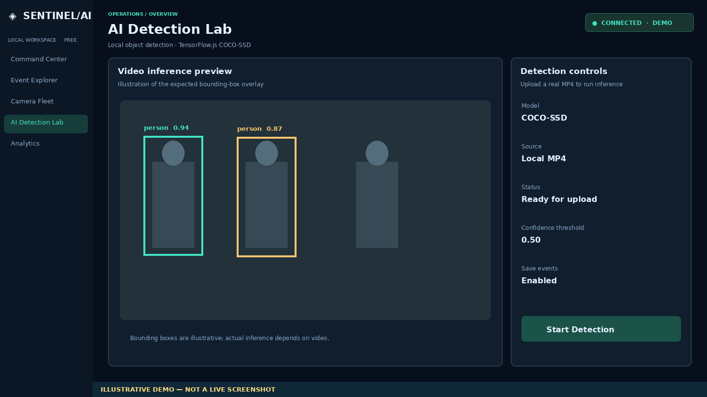
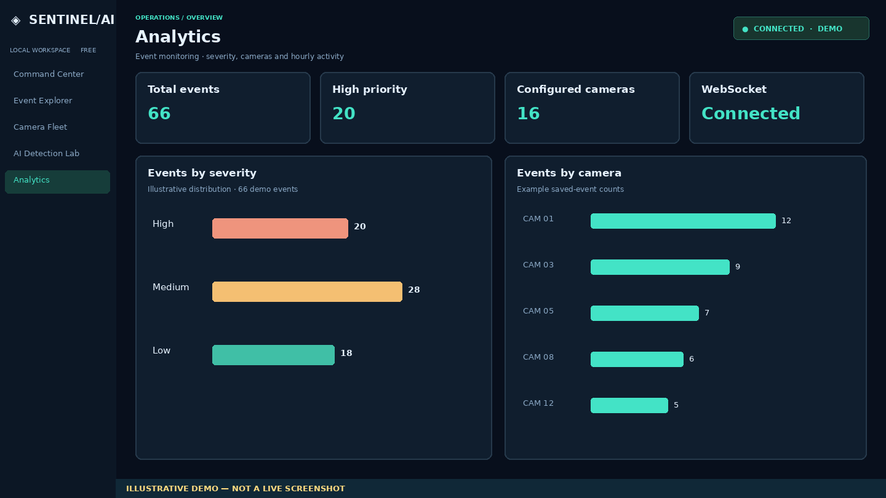

# Sentinel/AI — Fullstack Video Intelligence Portfolio

A local-first React + Node.js demo with a 16-camera wall, searchable events, camera management, AI Detection Lab, analytics, WebSocket updates and SQLite persistence.

> **Screenshots:** Command Center is an actual full-window capture provided by the project owner. The other four full-window images are **illustrative demos**, not actual screenshots or proof that those sample results were generated by the running app.

> **Demo transparency:** The 16 bundled MP4s are *simulated animated scenes*, not authentic CCTV or stock footage. Screenshots labeled **Actual UI capture** below were provided from a running instance; the other visuals are explicitly labeled **illustrative guides**, not screenshots of executed features. AI detection depends on recognizable objects in a real video uploaded by the user.

## Quick start (Windows / PowerShell)

```powershell
npm.cmd install
npm.cmd run dev
```

Open **http://localhost:5173**. To run checks:

```powershell
npm.cmd test
npm.cmd run build
npm.cmd run verify:videos
```

## 1. Command Center — Camera Wall



*Full-window screenshot from the running application, provided by the project owner. The bundled clips are simulated scenes.*

The camera wall displays camera names, status and video. Toggle between **3 × 3** and **4 × 4**, pause/resume, and click a camera to focus it. The **Detection Timeline** shows recent saved events. **Latest Events** includes the checkbox **Simulate an event every 9 seconds** for demo data.

## 2. Event Explorer — Searchable Event History



*Illustrative demo only — not a live screenshot. Replace with an actual full-window capture when available.*

**How to demonstrate search:**

1. Go to **Command Center**, find **Latest Events**, and tick **Simulate an event every 9 seconds** (do not type this sentence into the search box).
2. Wait around 30 seconds, then open **Event Explorer**.
3. Try terms such as `Movement`, `Object`, `North Entrance`, or a camera name; results depend on saved events.
4. Click **All Events**, **High**, **Medium**, or **Low** to filter. Clicking an event opens its camera.


## 3. Camera Fleet — Configure and upload feeds



*Illustrative demo only — not a live screenshot. Replace with an actual full-window capture when available.*

Choose **Camera Fleet** to add a camera, edit its name and zone, enable/disable it, delete it, or use **Upload MP4** to replace the bundled simulated feed. Each camera has its own source. The local upload limit is 100 MB per MP4.

## 4. AI Detection Lab — Object detection



*Illustrative demo only — not a live screenshot. Replace with an actual full-window capture when available.*

Upload a real MP4 with visible objects, load the COCO-SSD model, and run inference. The model may need internet access on first use. Detection quality depends on the source; the bundled animated videos are not suitable evidence of accurate AI detection. Detection metadata can be saved as events.

## 5. Analytics — Explore stored events



*Illustrative demo only — not a live screenshot. Replace with an actual full-window capture when available.*

After events have been saved, open **Analytics** to explore event summaries. When no events exist, the charts may be empty.

## System architecture

```text
React + Vite (camera wall, search, charts)
     | REST API / WebSocket
Node.js + Express (cameras, events, uploads)
     |
SQLite (persistent metadata)

HTML5 video -> TensorFlow.js COCO-SSD -> Canvas overlays / event metadata
```

See [Architecture](docs/ARCHITECTURE.md), [Interview Guide](docs/INTERVIEW_GUIDE.md), [Code Comments](docs/CODE_COMMENTS.md), [Run and Test](docs/RUN_AND_TEST.md), and [Video Setup](docs/VIDEO_SETUP.md).

## GitHub portfolio notes

- The four illustrated full-window views are design examples. Replace them with actual captures before claiming they demonstrate executed features.
- Do not describe demo animations as real surveillance footage or live streams.
- `node_modules`, local SQLite data, and user uploads are not committed.
- Source code contains English explanatory comments for important backend, AI and video logic.
